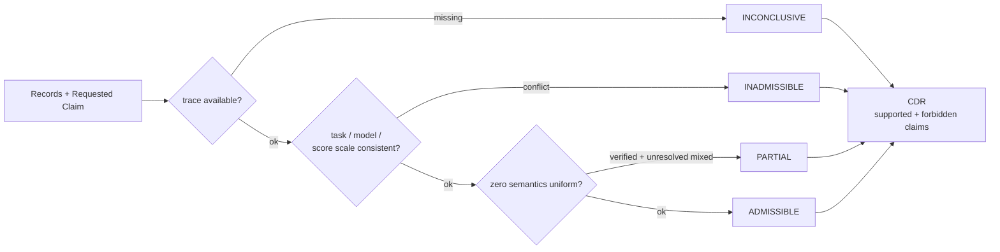

<div align="center">

# Agent Comparability

**Experimental Specification & Conformance Suite** for AI agent evaluation comparability

[](https://github.com/Rethymus/agent-comparability/actions/workflows/ci.yml)
[](LICENSE)
[](pyproject.toml)
[](https://pypi.org/project/agent-comparability/)

**English** | [简体中文](README.zh-CN.md)

*When can you compare AI agent evaluation results — and what claims do they support?*

</div>

---

> [!IMPORTANT]
> This project adjudicates **comparability of evaluation records** — it does **not** run
> agents, score benchmarks, or certify any agent's reliability. Passing the conformance
> suite means *specification* conformance, nothing more.

**The 30-second path**: [Install](#6-installation) → [Quickstart](#7-quickstart) →
[Real input/output](#8-inputoutput-example-actual-output).

<details open>
<summary><b>Table of Contents</b></summary>

1. [Project Overview](#1-project-overview)
2. [Problem & Motivation](#2-problem--motivation)
3. [What Agent Comparability Does](#3-what-agent-comparability-does)
4. [What It Does Not Do](#4-what-it-does-not-do)
5. [Main Features](#5-main-features)
6. [Installation](#6-installation)
7. [Quickstart](#7-quickstart)
8. [Input/Output Example (actual output)](#8-inputoutput-example-actual-output)
9. [Architecture](#9-architecture)
10. [Conformance Suite](#10-conformance-suite)
11. [Inspect AI / Pydantic Evals Integrations](#11-inspect-ai--pydantic-evals-integrations)
12. [Specification & Versioning](#12-specification--versioning)
13. [Limitations](#13-limitations)
14. [Contributing](#14-contributing)
15. [Security](#15-security)
16. [License & Acknowledgements](#16-license--acknowledgements)

[FAQ](#faq) · [Project status](#project-status)

</details>

---

## 1. Project Overview

Agent Comparability is a framework-independent **specification** ([spec/SPEC.md](spec/SPEC.md)),
a frozen **conformance suite**, and a thin **reference implementation** that adjudicates
*comparability* of agent evaluation records — never the scores themselves.

**Does it actually refuse unsupported claims?** See
[experiments/scenarios_001/RECORD.md](experiments/scenarios_001/RECORD.md): four real-pipeline
scenarios (real `.eval` logs → converter → core) covering all four verdicts — including the
confounded comparison and the missing-trajectory case, both correctly **refused** rather than
packaged as supported conclusions.

**Who is this for**: developers comparing agent/prompt/harness evaluation results,
benchmark authors documenting what conclusions their data supports, and teams building
reliability pipelines on top of existing eval frameworks.

### How it relates to existing tools

| Tool | What it does | Relation to Agent Comparability |
|---|---|---|
| [Inspect AI](https://inspect.aisi.org.uk) | Runs evals, agents, sandboxes | Complementary — Inspect *executes*; this decides what comparisons its results support. Adapter provided. |
| [Pydantic Evals](https://pydantic.dev) | Datasets, cases, reporting | Complementary reporting layer over the same core. Adapter provided. |
| Benchmark harnesses (lm-eval, SWE-bench, …) | Measure models | They *produce* records; this adjudicates what comparisons of those records mean |

## 2. Problem & Motivation

Three failure modes silently corrupt agent-evaluation conclusions:

| Failure mode | What actually goes wrong |
|---|---|
| **Semantics mixing** | A *verified failure* and an *unresolved zero* both read `0.0` — pooled "fail rates" become meaningless |
| **Confounded variables** | Model and harness change at the same time — a two-variable diff gets reported as causation |
| **Evidence gaps** | Missing traces quietly inflate success rates; rankings reverse across harnesses |

These boundaries should be **machine-checkable**, not vibes. That is what this project ships.
How this relates to benchmark-rigor and transcript-audit work (verified literature anchors):
see [docs/positioning.md](docs/positioning.md).

## 3. What Agent Comparability Does

- Adjudicates a **Requested Claim** (e.g. `score_comparison`, `causal`,
  `descriptive_registration`) against a set of evaluation records
- Returns a **Comparison Decision Record (CDR)**: admissibility
  (`ADMISSIBLE / INADMISSIBLE / PARTIAL / INCONCLUSIVE`), satisfied/violated/unknown
  conditions, **supported claims AND forbidden claims**, evidence refs, policy version
- Enforces evidence-trust tiers (agent-claimed vs source-verifier vs independently
  verified), score-scale consistency (range/unit/verifier), zero-semantics splits,
  and unknown-field/unknown-claim rules
- Ships a frozen conformance suite run against three separated metrics

**Admissibility quick reference** (full priority rules in [SPEC §3.3](spec/SPEC.md)):

| Verdict | Meaning | Typical trigger |
|---|---|---|
| `ADMISSIBLE` | Requested conclusion is supported | Same task / model / score scale, all records verified |
| `INADMISSIBLE` | Conclusion not supported | Confounded variables, task mismatch, or score-scale mismatch |
| `PARTIAL` | Only split presentation allowed | `verified` failures mixed with `unresolved_zero` |
| `INCONCLUSIVE` | Evidence insufficient to judge | Missing traces / evidence anchors |

## 4. What It Does Not Do

> [!WARNING]
> - Does **not** run agents, benchmarks, or models; no network, no credentials, no Docker
> - Does **not** score anything or certify any agent's reliability
> - Never merges its three conformance metrics into one number (see [§10](#10-conformance-suite))

## 5. Main Features

- `adjudicate(records, requested_claim) -> CDR` — pure Python, zero dependencies
- Priority-ordered decision table (evidence-missing > confounded > semantics > admissible)
- Machine-verifiable CDR JSON Schema ([spec/cdr.schema.json](spec/cdr.schema.json))
- Frozen A/B conformance case sets; B5 public erratum precedent protected
- Optional adapters for Inspect AI and Pydantic Evals reusing the same core

## 6. Installation

From PyPI (first published release: `0.5.2`):

```bash
pip install agent-comparability                            # minimal core, zero deps
pip install "agent-comparability[suite]"                   # + suite basics (pyyaml, jsonschema)
pip install "agent-comparability[suite,inspect,pydantic]"  # FULL conformance run
```

From a clone (development):

```bash
git clone https://github.com/Rethymus/agent-comparability.git && cd agent-comparability
pip install -e .                        # minimal core, zero deps
pip install -e .[suite]                 # + suite basics (pyyaml, jsonschema)
pip install -e .[suite,inspect,pydantic]  # FULL conformance run — required by run_suite.py
```

Requires Python ≥ 3.10. No Docker, no model keys. Note: the core package supports 3.10+;
the optional `inspect`/`pydantic` extras pull dependencies that require Python ≥ 3.11 —
on 3.10 pip resolves older versions of them.

## 7. Quickstart

**Command line** (offline, zero extra dependencies — input contract below):

```bash
python -m agent_comparability examples/demo-case.json --claim score_comparison
# → CDR JSON on stdout (exit 0). INADMISSIBLE / PARTIAL / INCONCLUSIVE are verdicts,
#   not program failures. Invalid input (bad JSON / missing or mistyped fields) →
#   exit 2 with a path-precise diagnostic — never silently converted into a verdict.
#   -o cdr.json writes to a file instead. The demo case is SYNTHETIC/illustrative.
```

Input contract (`{"id": str, "records": [{"task_id", "harness", "model", "reward":
number, "reward_status", ...optional}]}`); unknown record fields are ignored and
recorded in `unknown_conditions` (SPEC §5). Add `--manifest out.manifest.json` to
also emit an Evidence Manifest documenting artifact digests and evidence trust
states (never auto-upgraded; see [docs/evidence-manifest.md](docs/evidence-manifest.md)).
For five end-to-end walkthroughs (offline JSON, evidence manifest, single Inspect log,
cross-log comparison, validating a received CDR), see
[docs/usage-examples.md](docs/usage-examples.md). To validate a CDR **received** from
someone else before trusting it, run `python -m agent_comparability.validate cdr.json` —
consumer-side exit codes 0/1/2 (1 = unrecognized `policy_version`: discard the CDR and
re-adjudicate per SPEC §5, no partial trust; 2 = schema violation with field-precise
diagnostics); see Journey 5 in [docs/usage-examples.md](docs/usage-examples.md).
To self-check the installed environment, run `python -m agent_comparability doctor` —
a read-only diagnosis (packaged frozen cases present with A/B/D counts, adjudication
vs packaged frozen expectations, spec/policy version line consistent, demo CDR
producible) for PyPI users, who get neither `conformance/` nor `adapters/` in the
wheel and therefore cannot run the repo-local gates. A missing optional dependency is
reported as *not run* with the reason — never silently counted as passed.
Exit 0 = pass, 1 = any check failed; see Journey 6 in
[docs/usage-examples.md](docs/usage-examples.md).

**Python API**:

```python
from agent_comparability import adjudicate

cdr = adjudicate({"id": "demo", "records": [
    {"task_id": "t1", "harness": "h1", "model": "m1",
     "reward": 1.0, "reward_status": "verified"},
    {"task_id": "t1", "harness": "h2", "model": "m1",
     "reward": 0.0, "reward_status": "unresolved_zero"}]},
    "score_comparison")
```

## 8. Input/Output Example (actual output)

> Note: the reference implementation's condition/claim messages are currently in Chinese; the admissibility verdict itself is locale-neutral.

The quickstart call returns:

```
cdr.admissibility      -> PARTIAL
cdr.supported_claims   -> ['per_status_stratified_rate(verified_zero/unresolved_zero 分列)']
```

A confounded group instead:

```python
cdr = adjudicate({"id": "x", "records": [
    {"task_id": "a", "harness": "h1", "model": "m1", "reward": 1.0, "reward_status": "verified"},
    {"task_id": "b", "harness": "h2", "model": "m2", "reward": 0.0, "reward_status": "verified"}]},
    "score_comparison")
```

```
cdr.admissibility       -> INADMISSIBLE
cdr.violated_conditions -> ['same_task_id', 'same_model', 'single_variable_isolation']
```

`cdr.to_dict()` emits the full CDR (schema-validated). The quickstart call's complete
CDR — actual output:

```json
{
  "case_id": "demo",
  "requested_claim": "score_comparison",
  "comparison_scope": "2 records; models=['m1']; harnesses=['h1', 'h2']",
  "admissibility": "PARTIAL",
  "satisfied_conditions": [
    "same_task_id",
    "same_model",
    "single_variable_isolation",
    "continuous_score_preserved({'range': '0..1', 'unit': 'fraction', 'verifier': 'source'})"
  ],
  "violated_conditions": [
    "zero_semantics_uniform(verified_zero != unresolved_zero)"
  ],
  "unknown_conditions": [],
  "supported_claims": [
    "per_status_stratified_rate(verified_zero/unresolved_zero 分列)"
  ],
  "unsupported_claims": [
    "pooled_fail_rate(0 分语义混同)"
  ],
  "evidence_refs": [
    "rec:t1/m1/h1",
    "rec:t1/m1/h2"
  ],
  "policy_version": "cmp/0.4.0",
  "limitations": [
    "摘要一致仅证明未同步修改，不构成抗恶意篡改（单写信任域）"
  ]
}
```

## 9. Architecture

```
spec/SPEC.md                     ← single source of truth (readable standalone)
spec/cdr.schema.json             ← machine-verifiable CDR
src/agent_comparability/core.py  ← thin reference implementation
src/agent_comparability/data/    ← SPEC + schema + frozen cases (packaged)
conformance/                     ← run_suite.py (3 metrics) + independent_impl.py + cases
adapters/                        ← optional inspect-ai / pydantic-evals wrappers
tests/                           ← smoke + property tests
```

Adjudication flow (priority order, per [SPEC §3.3](spec/SPEC.md)):



## 10. Conformance Suite

`python conformance/run_suite.py` reports three **separated** metrics that must
never be merged:

1. **Policy correctness** — reference implementation vs frozen expectations
2. **Spec conformance** — an independent implementation written from SPEC alone
3. **Integration consistency** — the same core via Inspect/Pydantic adapters

A failure in each means a different defect class (implementation bug / spec
ambiguity or misread / adapter bug).

The full suite run requires the adapter extras (`.[suite,inspect,pydantic]`) — a missing adapter is treated as FAIL, not skipped.

`conformance-results.json` carries three provenance anchors: `policy_version` (spec generation), `package_version` (software line), and `case_set_digest` — a sha256 over the frozen corpus in canonical JSON (the A set contributes its expectations, its packaged form has no records; B/D also their records). Version anchors attribute an artifact to a generation but cannot see corpus content: tampering records *and* expectations consistently leaves metrics green, counts at 26 and both version anchors untouched — only the content anchor exposes it. `python -m agent_comparability doctor` reports the packaged-corpus digest (report-only; no embedded expected value): compare it with the CI artifact or the release notes to confirm both sides adjudicated the same corpus.

## 11. Inspect AI / Pydantic Evals Integrations

```bash
pip install -e .[inspect] && python adapters/inspect_adapter.py
pip install -e .[pydantic] && python adapters/pydantic_adapter.py
```

Both wrap the *same* core (no semantic duplication). Inspect scorer uses
`metrics=[]` — admissibility is deliberately **not** aggregated into accuracy.
The Pydantic evaluator checks the **task's real output** (`ctx.output`) against
frozen expectations — it never re-adjudicates inside the evaluator — and the
adapter's exit code derives from the full 26-pair `report` (cases + failures).
For **real Inspect EvalLog files** (not frozen cases) use the converter:
`python -m agent_comparability.inspect_log run.eval --claim … --status …`
(official APIs, explicit mapping policy, no silent guessing — see
[docs/inspect-log.md](docs/inspect-log.md)).

## 12. Specification & Versioning

Three distinct lines: software tag (e.g. `v0.5.0`), specification `cmp/0.4.0`
(inside SPEC), and `agent_comparability.__version__`. Judgment-table changes
require a spec major bump (SPEC §5). See [CHANGELOG](CHANGELOG.md) for the full tag lineage
(v0.3.1–v0.3.6 are deprecated candidates kept immutably for the record).

The packaged twins under `src/agent_comparability/data/` must stay identical to
their repo counterparts: `spec/SPEC.md`, `spec/cdr.schema.json`,
`conformance/boundary-cases.json` and `conformance/cases-0.4.json`
byte-identical; `frozen-cases-a.json` identical in expectation *content* — the
repo copy is a runtime projection rewritten by the inspect adapter with the
current `policy_version`, a documented metadata divergence. `conformance/release_gate.py`
enforces this; without it, the digest a PyPI user sees and the digest in a CI
artifact could silently drift apart.

## 13. Limitations

- Experimental specification; self-tested conformance, **no external certification**
- Single-writer trust domain: digest equality proves non-divergence, not
  tamper-resistance (SPEC §1) — this applies to the suite's `case_set_digest` too
- No repetition/cost modeling inside adjudication (handled by callers)
- Chinese/English docs kept equivalent; translation drift tracked in CI link checks

## FAQ

**Does passing the conformance suite certify my agent is reliable?**
No. It certifies that an *implementation* matches the specification. It says nothing about any agent.

**Can I use it with my existing eval framework?**
Yes. The core is framework-independent (`adjudicate()` is a pure function over record
dicts). Adapters for Inspect AI and Pydantic Evals are included; any framework whose
output you can map to the [record schema](spec/SPEC.md#0-范围与目的) works.

**Why not just compare scores?**
Because `0.0` can mean a *verified failure* or an *unresolved zero*; because model and
harness changing together turns a diff into an unfounded causal claim; and because
missing traces inflate success rates silently. §2's failure modes are all real-world
artifacts, not hypotheticals.

**Does it run agents or benchmarks?**
No — no network, no credentials, no Docker. It only ever sees the records you pass in.

**Which versions should I depend on?**
Package `v0.5.0+` (version lines unified and CI-enforced since then); specification
`cmp/0.4.0` evolves independently — see [§12](#12-specification--versioning).

## Project status

| Component | Status |
|---|---|
| Specification `cmp/0.4.0` | Stable — frozen conformance set anchors it |
| Claim types | `score_comparison`, `causal`, `descriptive_registration` (+ unknown → `INCONCLUSIVE`) |
| Conformance cases | 26 frozen pairs (A + B + D sets), three separated metrics, all green in CI |
| Adapters | Inspect AI ✓ · Pydantic Evals ✓ |
| CI gates | Terminal scan · bilingual docs · conformance ×3 · tests · release version · build + twine · package content |
| Repo governance | `main` protected (PR + required check), release tags `v*` immutable |
| Distribution | PyPI (`agent-comparability`, since `0.5.2`, Trusted Publishing) + GitHub source/tags |

## 14. Contributing

See [CONTRIBUTING.md](CONTRIBUTING.md). Key rule: **never edit frozen expectations
to make tests pass**; errata follow the public B5 precedent. PRs must pass all
three conformance metrics separately. AI contributors and coding agents: see
[AGENTS.md](AGENTS.md) for the binding rules (instruction-source priority,
closed check list, citation and data discipline).

## 15. Security

See [SECURITY.md](SECURITY.md). Private vulnerability reporting preferred.

## 16. License & Acknowledgements

Apache-2.0 (see [LICENSE](LICENSE), [NOTICE](NOTICE)). Optional integrations
inspect-ai / pydantic-evals are MIT and **not bundled**. Conformance case data is
original to this project; no CC BY-NC data is distributed. Research lineage:
this repo was distilled from a private research repository; internal process
records live under `docs/internal/`.
