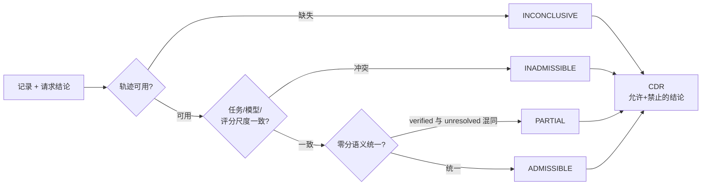

<div align="center">

# Agent Comparability

**面向 AI Agent 评测可比较性的实验性规范与一致性测试套件**

[](https://github.com/Rethymus/agent-comparability/actions/workflows/ci.yml)
[](LICENSE)
[](pyproject.toml)
[](https://pypi.org/project/agent-comparability/)

[English](README.md) | **简体中文**

*什么时候可以比较 AI Agent 的评测结果——它们又能支持什么结论？*

</div>

---

> [!IMPORTANT]
> 本项目裁决的是**评测记录的可比较性**——它**不**运行 Agent、不跑基准、不对任何 Agent
> 的可靠性作认证。一致性套件通过，仅代表*规范*一致性，仅此而已。

**30 秒路径**：[安装](#6-安装) → [快速开始](#7-快速开始) →
[真实输入/输出](#8-输入输出示例真实输出)。

<details open>
<summary><b>目录</b></summary>

1. [项目概览](#1-项目概览)
2. [问题与动机](#2-问题与动机)
3. [它做什么](#3-它做什么)
4. [它不做什么](#4-它不做什么)
5. [主要特性](#5-主要特性)
6. [安装](#6-安装)
7. [快速开始](#7-快速开始)
8. [输入/输出示例（真实输出）](#8-输入输出示例真实输出)
9. [架构](#9-架构)
10. [一致性套件](#10-一致性套件)
11. [Inspect AI / Pydantic Evals 集成](#11-inspect-ai--pydantic-evals-集成)
12. [规范与版本](#12-规范与版本)
13. [局限](#13-局限)
14. [参与贡献](#14-参与贡献)
15. [安全](#15-安全)
16. [许可与致谢](#16-许可与致谢)

[常见问题](#常见问题) · [项目状态](#项目状态)

</details>

---

## 1. 项目概览

Agent Comparability 是一套与框架无关的**规范**（[spec/SPEC.md](spec/SPEC.md)）、冻结的**一致性测试套件**和极薄的**参考实现**，它裁决的是 Agent 评测记录的*可比性*——从不为分数本身评分。

**它真的会拒绝无依据的主张吗？** 见
[experiments/scenarios_001/RECORD.md](experiments/scenarios_001/RECORD.md)：四个真实管线场景
（真实 `.eval` 日志 → 转换器 → 核心）覆盖全部四种裁决——其中混淆比较与轨迹缺失两例均被
**正确拒绝**，而非包装成受支持的结论。

**适用人群**：需要比较 Agent/Prompt/Harness 评测结果的开发者、希望说明"自己的基准数据支持什么结论"的基准作者、以及在现有评测框架之上构建可靠性管线的团队。

### 与现有工具的关系

| 工具 | 它做什么 | 与本项目的关系 |
|---|---|---|
| [Inspect AI](https://inspect.aisi.org.uk) | 运行评测、Agent、沙箱 | 互补——Inspect 负责*执行*；本项目裁决其结果支持什么比较。提供适配器。 |
| [Pydantic Evals](https://pydantic.dev) | 数据集、用例、报告 | 互补的报告层，经适配器复用同一核心。 |
| 基准框架（lm-eval、SWE-bench 等） | 测量模型 | 它们*产出*记录；本项目裁决这些记录之间的比较意味着什么 |

## 2. 问题与动机

三种失效模式在悄然腐蚀 Agent 评测结论：

| 失效模式 | 实际发生了什么 |
|---|---|
| **语义混同** | *已验证的失败*与*未解出的零分*都显示 `0.0`——合并后的"失败率"失去意义 |
| **变量混淆** | 模型与 Harness 同时变化——双变量差异被当成因果结论报告 |
| **证据缺口** | 轨迹缺失悄然抬高成功率；排名随 Harness 反转 |

这些边界应当**机器可校验**，而非凭感觉——这正是本项目交付的东西。
与基准严谨性/轨迹审计类工作的关系（经核实的文献锚点）见
[docs/positioning.md](docs/positioning.md)。

## 3. 它做什么

- 针对一组评测记录裁决**请求结论**（如 `score_comparison`、`causal`、`descriptive_registration`）
- 返回**比较决策记录（CDR）**：可采纳性（`ADMISSIBLE / INADMISSIBLE / PARTIAL / INCONCLUSIVE`）、满足/违反/未知条件、**允许的结论与禁止的结论**、证据引用、规范版本
- 强制证据信任分层（Agent 自报 / 来源验证器 / 独立复验）、评分尺度一致性（范围/单位/验证器）、零分语义拆分、未知字段与未知结论规则
- 内置冻结一致性套件，按三个分离指标运行

**可采纳性速查**（完整优先级规则见 [SPEC §3.3](spec/SPEC.md)）：

| 判定 | 含义 | 典型触发 |
|---|---|---|
| `ADMISSIBLE` | 所请求结论获得支持 | 同任务/模型/评分尺度，全部 verified |
| `INADMISSIBLE` | 结论不被支持 | 变量混淆、任务不一致或评分尺度不一致 |
| `PARTIAL` | 仅允许拆分形式呈现 | `verified` 失败与 `unresolved_zero` 混同 |
| `INCONCLUSIVE` | 证据不足以判定 | 轨迹缺失/证据锚点缺失 |

## 4. 它不做什么

> [!WARNING]
> - **不**运行 Agent、基准或模型；无网络、无凭据、无需 Docker
> - **不**为任何东西评分、**不**认证任何 Agent 的可靠性
> - 绝不把三个一致性指标合并成一个数字（见[第 10 节](#10-一致性套件)）

## 5. 主要特性

- `adjudicate(records, requested_claim) -> CDR`——纯 Python、零依赖
- 优先级排序的判定表（证据缺失 > 条件混淆 > 语义分裂 > 可采纳）
- 机器可校验的 CDR JSON Schema（[spec/cdr.schema.json](spec/cdr.schema.json)）
- 冻结的 A/B 一致性案例集；B5 公开勘误先例受保护
- 可选的 Inspect AI 与 Pydantic Evals 适配器复用同一核心

## 6. 安装

从 PyPI 安装（首个发布版本：`0.5.2`）：

```bash
pip install agent-comparability                            # 最小核心，零依赖
pip install "agent-comparability[suite]"                   # + 套件基础（pyyaml、jsonschema）
pip install "agent-comparability[suite,inspect,pydantic]"  # 完整 Conformance 运行
```

从克隆安装（开发）：

```bash
git clone https://github.com/Rethymus/agent-comparability.git && cd agent-comparability
pip install -e .                        # 最小核心，零依赖
pip install -e .[suite]                 # + 套件基础（pyyaml、jsonschema）
pip install -e .[suite,inspect,pydantic]  # 完整 Conformance 运行——run_suite.py 必需
```

要求 Python ≥ 3.10。无需 Docker、无需模型密钥。注意：核心包支持 3.10+；可选的
`inspect`/`pydantic` 扩展引入的依赖要求 Python ≥ 3.11——在 3.10 上 pip 会解析为其旧版本。

## 7. 快速开始

**命令行**（离线，零额外依赖——输入契约见下）：

```bash
python -m agent_comparability examples/demo-case.json --claim score_comparison
# → stdout 输出 CDR JSON（exit 0）。INADMISSIBLE / PARTIAL / INCONCLUSIVE 是裁决结果，
#   不是程序失败。无效输入（JSON 损坏/字段缺失或类型错）→ exit 2 并给出精确到
#   字段路径的诊断——绝不被静默转换为貌似成功的裁决。
#   -o cdr.json 改为写入文件。演示案例为合成/示意数据（SYNTHETIC/illustrative）。
```

输入契约（`{"id": str, "records": [{"task_id", "harness", "model", "reward":
数值, "reward_status", ...可选字段}]}`）；Record 未知字段按 SPEC §5 忽略并记入
`unknown_conditions`。加 `--manifest out.manifest.json` 可同时输出 Evidence
Manifest，记录制品摘要与证据可信状态（绝不自动升级；见
[docs/evidence-manifest.md](docs/evidence-manifest.md)）。

**Python API**：

```python
from agent_comparability import adjudicate

cdr = adjudicate({"id": "demo", "records": [
    {"task_id": "t1", "harness": "h1", "model": "m1",
     "reward": 1.0, "reward_status": "verified"},
    {"task_id": "t1", "harness": "h2", "model": "m1",
     "reward": 0.0, "reward_status": "unresolved_zero"}]},
    "score_comparison")
```

## 8. 输入/输出示例（真实输出）

> 注：参考实现的条件/结论消息当前为中文；可采纳性判定本身与语言无关。

上面的调用返回：

```
cdr.admissibility      -> PARTIAL
cdr.supported_claims   -> ['per_status_stratified_rate(verified_zero/unresolved_zero 分列)']
```

换成一个条件混淆的组：

```python
cdr = adjudicate({"id": "x", "records": [
    {"task_id": "a", "harness": "h1", "model": "m1", "reward": 1.0, "reward_status": "verified"},
    {"task_id": "b", "harness": "h2", "model": "m2", "reward": 0.0, "reward_status": "verified"}]},
    "score_comparison")
```

```
cdr.admissibility       -> INADMISSIBLE
cdr.violated_conditions -> ['same_task_id', 'same_model', 'single_variable_isolation']
```

`cdr.to_dict()` 输出完整 CDR（经 schema 校验）。上面快速开始调用的完整 CDR——真实输出：

```json
{
  "case_id": "demo",
  "requested_claim": "score_comparison",
  "comparison_scope": "2 records; models=['m1']; harnesses=['h1', 'h2']",
  "admissibility": "PARTIAL",
  "satisfied_conditions": [
    "same_task_id",
    "same_model",
    "single_variable_isolation",
    "continuous_score_preserved({'range': '0..1', 'unit': 'fraction', 'verifier': 'source'})"
  ],
  "violated_conditions": [
    "zero_semantics_uniform(verified_zero != unresolved_zero)"
  ],
  "unknown_conditions": [],
  "supported_claims": [
    "per_status_stratified_rate(verified_zero/unresolved_zero 分列)"
  ],
  "unsupported_claims": [
    "pooled_fail_rate(0 分语义混同)"
  ],
  "evidence_refs": [
    "rec:t1/m1/h1",
    "rec:t1/m1/h2"
  ],
  "policy_version": "cmp/0.4.0",
  "limitations": [
    "摘要一致仅证明未同步修改，不构成抗恶意篡改（单写信任域）"
  ]
}
```

## 9. 架构

```
spec/SPEC.md                     ← 单一事实来源（可独立阅读）
spec/cdr.schema.json             ← 机器可校验的 CDR
src/agent_comparability/core.py  ← 极薄参考实现
src/agent_comparability/data/    ← SPEC + schema + 冻结案例（随包分发）
conformance/                     ← run_suite.py（三指标）+ independent_impl.py + 案例
adapters/                        ← 可选 inspect-ai / pydantic-evals 封装
tests/                           ← 冒烟 + 属性测试
```

判定流程（优先级顺序，依据 [SPEC §3.3](spec/SPEC.md)）：



## 10. 一致性套件

`python conformance/run_suite.py` 输出三个**分离**的指标，**绝不合并**：

1. **策略正确性**——参考实现 vs 冻结预期
2. **规范一致性**——仅依规范文本编写的独立实现
3. **集成一致性**——同一核心经 Inspect/Pydantic 适配器调用

每个指标的失败对应不同缺陷类别（实现 bug / 规范歧义或误读 / 适配器 bug）。

完整套件运行需要适配器扩展（`.[suite,inspect,pydantic]`）——适配器缺失按 FAIL 处理，不会静默跳过。

## 11. Inspect AI / Pydantic Evals 集成

```bash
pip install -e .[inspect] && python adapters/inspect_adapter.py
pip install -e .[pydantic] && python adapters/pydantic_adapter.py
```

两者封装*同一个*核心（语义零重复）。Inspect scorer 使用 `metrics=[]`——可采纳性**不**被聚合为准确率。
Pydantic 评估器检查**被评测 task 的真实输出**（`ctx.output`）与冻结预期一致——评估器内部
绝不重算判定——适配器退出码取自全 22 对的 `report`（cases + failures）。
转换**真实 Inspect EvalLog 文件**（非冻结案例）请用转换器：
`python -m agent_comparability.inspect_log run.eval --claim … --status …`
（官方 API、显式映射政策、禁止静默猜测——见 [docs/inspect-log.md](docs/inspect-log.md)）。

## 12. 规范与版本

三条独立版本线：软件 tag（如 `v0.5.0`）、规范 `cmp/0.4.0`（在 SPEC 内）、`agent_comparability.__version__`。判定表变更须规范升 major（SPEC §5）。完整 tag 谱系见 [CHANGELOG](CHANGELOG.md)（v0.3.1–v0.3.6 为保留不动的废弃候选）。

## 13. 局限

- 实验性规范；自测一致性，**无外部认证**
- 单写信任域：摘要一致仅证明未分叉，不证明抗篡改（SPEC §1）
- 判定内部不含重复次数/成本建模（由调用方处理）
- 中英文文档保持信息等价；翻译漂移由 CI 链接检查跟踪

## 常见问题

**通过一致性套件是否证明我的 Agent 可靠？**
不。它证明的是某个*实现*符合规范，对任何 Agent 不作任何陈述。

**能与我现有的评测框架一起用吗？**
能。核心与框架无关（`adjudicate()` 是对记录字典的纯函数）。内置 Inspect AI 与
Pydantic Evals 适配器；任何能映射到[记录结构](spec/SPEC.md#0-范围与目的)的框架都可用。

**为什么不直接比较分数？**
因为 `0.0` 可能是*已验证的失败*也可能是*未解出的零分*；因为模型与 Harness 同时
变化会把双变量差异变成无根据的因果结论；因为轨迹缺失会悄然抬高成功率。第 2 节的
失效模式都来自真实数据，不是假设。

**它会运行 Agent 或基准吗？**
不会——无网络、无凭据、无需 Docker。它只读取你传入的记录。

**该依赖哪个版本？**
包 `v0.5.0+`（此后版本线统一并由 CI 强制）；规范 `cmp/0.4.0` 独立演进——见
[第 12 节](#12-规范与版本)。

## 项目状态

| 组件 | 状态 |
|---|---|
| 规范 `cmp/0.4.0` | 稳定——由冻结一致性集锚定 |
| 结论类型 | `score_comparison`、`causal`、`descriptive_registration`（未知类型 → `INCONCLUSIVE`） |
| 一致性案例 | 22 对冻结（A + B 集），三个分离指标，CI 全绿 |
| 适配器 | Inspect AI ✓ · Pydantic Evals ✓ |
| CI 门禁 | 终扫 · 双语文档 · 一致性×3 · 测试 · 发行版本 · build+twine · 包内容 |
| 仓库治理 | `main` 受保护（PR + 必需检查），发行 tag `v*` 不可变 |
| 分发 | PyPI（`agent-comparability`，自 `0.5.2` 起，Trusted Publishing）+ GitHub 源码/tag |

## 14. 参与贡献

见 [CONTRIBUTING.md](CONTRIBUTING.md)。关键规则：**绝不为了让测试通过而修改冻结预期**；勘误遵循 B5 公开先例。PR 必须分别通过三个一致性指标。

## 15. 安全

见 [SECURITY.md](SECURITY.md)。优先使用私有漏洞报告渠道。

## 16. 许可与致谢

Apache-2.0（见 [LICENSE](LICENSE)、[NOTICE](NOTICE)）。可选集成 inspect-ai / pydantic-evals 为 MIT 且**不随包分发**。一致性案例数据为本项目原创；不分发任何 CC BY-NC 数据。研究脉络：本仓库从私有研究仓库蒸馏而来；内部过程记录在 `docs/internal/`。
